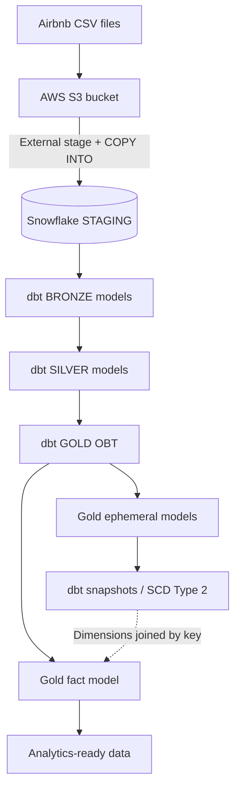

# Airbnb Data Pipeline | AWS S3, Snowflake & dbt

An end-to-end **data engineering portfolio project** that takes Airbnb-style booking, listing, and host data through cloud ingestion, SQL transformations, and analytics-ready data models.

The pipeline uses **Amazon S3** as the external file landing zone, **Snowflake** for storage and compute, and **dbt Core** for transformation, reusable Jinja macros, snapshots, and dimensional modeling.

> **Project scope:** This repository contains the dbt transformation project and Python dependency definitions. The AWS S3 setup and Snowflake ingestion steps are performed outside this repository; there is no automated S3-to-Snowflake ingestion script checked in.

## Architecture



The project uses three source entities: **bookings**, **listings**, and **hosts**. The Gold layer builds an **OBT (One Big Table)** and a fact-oriented output. Snapshot definitions build historical dimension tables from the ephemeral models.

## Tech Stack

| Technology | Role |
| --- | --- |
| **AWS S3** | Landing zone for source CSV files |
| **Snowflake** | Data warehouse, external stage, SQL execution, and storage |
| **dbt Core** + **dbt-snowflake** | Transformation, dependencies, materializations, and snapshots |
| **SQL & Jinja** | Cleaning, derivations, configurable joins, and macros |
| **Python & uv** | Local dependency/environment management |
| **Git & GitHub** | Version control and project documentation |

## Data Transformation Layers

### 1. STAGING — Snowflake source tables

Source definitions are in [`models/sources/sources.yml`](aws_dbt_snowflake_project/models/sources/sources.yml). dbt reads the following Snowflake relations:

- `AIRBNB.STAGING.BOOKINGS`
- `AIRBNB.STAGING.LISTINGS`
- `AIRBNB.STAGING.HOSTS`

In the original ingestion workflow, source files are staged in S3 and loaded to Snowflake using an external stage and `COPY INTO`. The dbt project starts from the existing Snowflake staging tables.

### 2. BRONZE — Incremental source models

The three models (`bronze_bookings`, `bronze_listings`, and `bronze_hosts`) use **incremental materialization**, loading rows whose `CREATED_AT` is greater than the maximum already present in the target table.

```sql
{{ config(materialized='incremental') }}

SELECT *
FROM {{ source('staging', 'bookings') }}


    WHERE CREATED_AT > (
        SELECT COALESCE(MAX(CREATED_AT), '1900-01-01')
        FROM {{ this }}
    )

```

**Note:** This is a `CREATED_AT`-based append approach. It is not designed to capture changes to old records that retain their original `CREATED_AT` value.

### 3. SILVER — Cleaning and enrichment

The Silver models create standardized, enriched fields:

| Model | Transformations present in the code |
| --- | --- |
| `silver_bookings` | Booking columns, calculated `TOTAL_PRICE`, cleaning/service fees, booking status |
| `silver_listings` | Property and room attributes; nightly-price band using the `tag` macro |
| `silver_hosts` | Host-name formatting and response-rate category (`VERY GOOD`, `GOOD`, `POOR`) |

For example, `silver_bookings` calculates `TOTAL_PRICE` using the reusable `multiply` macro:

```sql
{{ multiply('NIGHTS_BOOKED', 'BOOKING_AMOUNT', 2) }} AS TOTAL_PRICE
```

The `silver_*` models declare incremental materialization and business keys. They currently **do not add an `is_incremental()` source filter**, so the input query can be reprocessed on subsequent runs.

### 4. GOLD — OBT and fact model

[`models/gold/obt.sql`](aws_dbt_snowflake_project/models/gold/obt.sql) uses Jinja loops to assemble a `SELECT` and a set of `LEFT JOIN`s across the three Silver tables:

```text
SILVER_BOOKINGS
    LEFT JOIN SILVER_LISTINGS ON LISTING_ID
    LEFT JOIN SILVER_HOSTS    ON HOST_ID
                   |
                   v
                 GOLD.OBT
```

The OBT combines booking measures with listing and host attributes, including `TOTAL_PRICE`, `PRICE_PER_NIGHT_TAG`, and `RESPONSE_RATE_TAG`.

[`models/gold/fact.sql`](aws_dbt_snowflake_project/models/gold/fact.sql) selects booking facts and related attributes from `AIRBNB.GOLD.OBT`, then joins the historical dimension relations `AIRBNB.GOLD.DIM_LISTINGS` and `AIRBNB.GOLD.DIM_HOSTS`.

> **Modeling caution:** Those snapshots may contain multiple historical versions for a single `LISTING_ID` or `HOST_ID`. The current fact JOINs do not filter on the validity period, so they may duplicate booking rows. Historical or current-version joins should be implemented before using this model for production metrics.

### 5. Ephemeral models and snapshots

The repository defines three **ephemeral models** under `models/gold/ephemeral/`: `bookings`, `listings`, and `hosts`. Each selects a focused set of attributes from `obt`. Ephemeral models are compiled into dependent queries as CTEs rather than materialized as standalone tables.

Three YAML snapshot definitions in `snapshots/` reference these ephemeral models:

| Snapshot | Input model | Unique key | Timestamp column |
| --- | --- | --- | --- |
| `dim_bookings` | `bookings` | `BOOKING_ID` | `CREATED_AT` |
| `dim_listings` | `listings` | `LISTING_ID` | `LISTING_CREATED_AT` |
| `dim_hosts` | `hosts` | `HOST_ID` | `HOST_CREATED_AT` |

The snapshot configs use the **timestamp** strategy to record history as SCD Type 2 rows, with a configured far-future validity end date for current records.

> **Snapshot limitation:** The configured timestamps describe record creation, not necessarily the latest modification. Changes may not be detected unless those timestamp values advance. A reliable `UPDATED_AT` column (or a suitable `check` strategy) would improve historical change tracking.

## Reusable Jinja Macros

Custom macros live in [`macros/`](aws_dbt_snowflake_project/macros/):

| Macro | Purpose |
| --- | --- |
| `multiply(x, y, precision)` | Multiplies numeric expressions and rounds the result |
| `tag(col)` | Maps a numeric price to `low` (under 100), `medium` (under 200), or `high` |
| `trimmer(column_name, node)` | Trims and uppercases the provided Jinja string/expression |
| `generate_schema_name(custom_schema_name, node)` | Overrides dbt's schema-naming behavior to use a custom schema directly |

Example:

```sql
{{ tag('CAST(PRICE_PER_NIGHT AS INT)') }} AS PRICE_PER_NIGHT_TAG
```

This compiles to a Snowflake `CASE` expression. The macro produces SQL; Snowflake evaluates that expression against each row.

## Repository Structure

```text
AWS-SNOWFLAE-DBT/
├── README.md
├── .gitignore
├── .python-version
├── pyproject.toml
├── uv.lock
├── src/
│   └── aws_snowflae_dbt/
└── aws_dbt_snowflake_project/
    ├── dbt_project.yml
    ├── models/
    │   ├── sources/
    │   │   └── sources.yml
    │   ├── bronze/
    │   ├── silver/
    │   └── gold/
    │       ├── ephemeral/
    │       ├── obt.sql
    │       └── fact.sql
    ├── macros/
    ├── snapshots/
    ├── analyses/
    ├── seeds/
    └── tests/
```

`seeds/` and `tests/` are present as project directories; this repository does not currently include a populated seed dataset or a dedicated suite of SQL data tests.

## Getting Started

### Prerequisites

- Python **3.10+** and [uv](https://docs.astral.sh/uv/)
- A Snowflake account with access to a warehouse and the `AIRBNB` database
- The three Snowflake STAGING tables already loaded: `BOOKINGS`, `LISTINGS`, `HOSTS`
- A dbt-compatible Snowflake user and role with required read/write permissions

### 1. Clone and install dependencies

```bash
git clone https://github.com/Vamp-L/aws-snowflake-dbt-pipeline.git
cd aws-snowflake-dbt-pipeline
uv sync
```

The `pyproject.toml` declares `dbt-snowflake`, which installs the Snowflake adapter and compatible dbt dependencies.

### 2. Set up local Snowflake credentials

Create `aws_dbt_snowflake_project/profiles.yml` **locally** (this file is intentionally excluded from Git):

```yaml
aws_dbt_snowflake_project:
  target: dev
  outputs:
    dev:
      type: snowflake
      account: "{{ env_var('SNOWFLAKE_ACCOUNT') }}"
      user: "{{ env_var('SNOWFLAKE_USER') }}"
      password: "{{ env_var('SNOWFLAKE_PASSWORD') }}"
      role: "{{ env_var('SNOWFLAKE_ROLE') }}"
      warehouse: "{{ env_var('SNOWFLAKE_WAREHOUSE') }}"
      database: AIRBNB
      schema: dbt_schema
      threads: 4
```

Set the five environment variables in your local shell or a secure secrets manager. **Never commit the real `profiles.yml`, credentials, or `.env` files.**

### 3. Test the dbt connection

From the repository root:

```bash
uv run dbt debug --project-dir aws_dbt_snowflake_project --profiles-dir aws_dbt_snowflake_project
```

### 4. Build transformations and snapshots

The models use some explicit Snowflake relation names (for example `AIRBNB.SILVER.*` and `AIRBNB.GOLD.*`), so the database and schema layout should match the project configuration.

```bash
# Build the Bronze, Silver, and OBT dependencies
uv run dbt run --project-dir aws_dbt_snowflake_project --profiles-dir aws_dbt_snowflake_project --select +obt

# Create/update dimension snapshots
uv run dbt snapshot --project-dir aws_dbt_snowflake_project --profiles-dir aws_dbt_snowflake_project

# Build the fact model after dimension snapshots exist
uv run dbt run --project-dir aws_dbt_snowflake_project --profiles-dir aws_dbt_snowflake_project --select fact
```

Inspect dbt's compiled SQL and execution output if the configured schemas, grants, or snapshot dependencies differ in your environment. The repository demonstrates the transformation design but does not include a published deployment run log or CI validation report.

## Future Improvements

- Replace hard-coded Gold/Silver relation names with `ref()` to strengthen dbt lineage and environment portability.
- Add `unique` / `not_null` / `relationships` data tests and source freshness checks.
- Refine incremental strategies to handle late-arriving records and updates.
- Change snapshot change-detection columns to reliable update timestamps where available.
- Resolve potential duplicate column names in the OBT and use version-aware dimension joins in the fact model.
- Add a reproducible S3-to-Snowflake ingestion script and CI checks.
- Provide example analytics queries and screenshots of successful Snowflake/dbt outputs.

## Security Notes

The public repository should include **code and documentation only**, not Snowflake passwords, personal access tokens, AWS access keys, local profiles, or logs. If credentials were ever committed, remove them from the published history **and rotate/revoke them**, even if the files are no longer tracked.

---

**Project type:** Personal Data Engineering portfolio project · **Domain:** Airbnb bookings and property analytics
